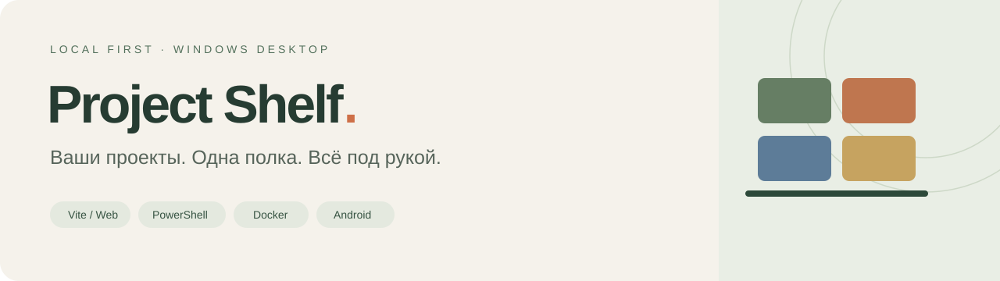
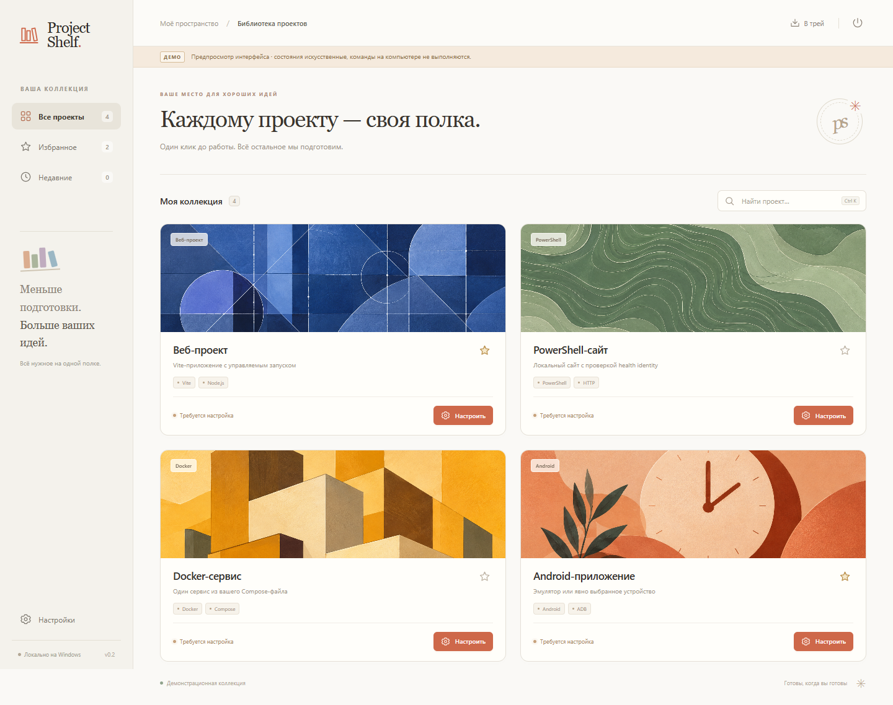
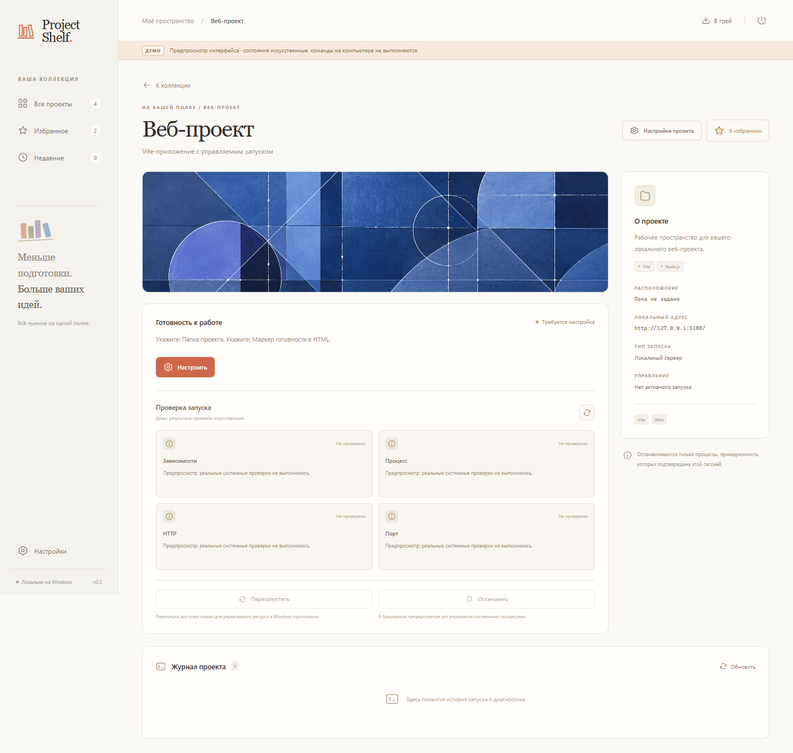
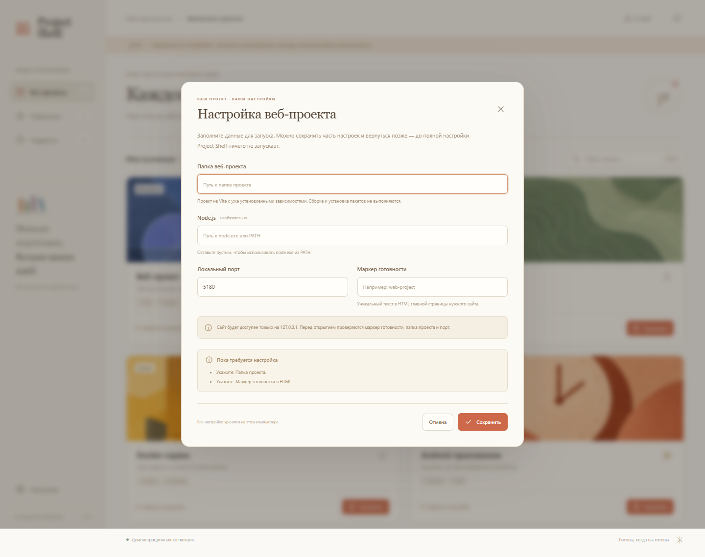
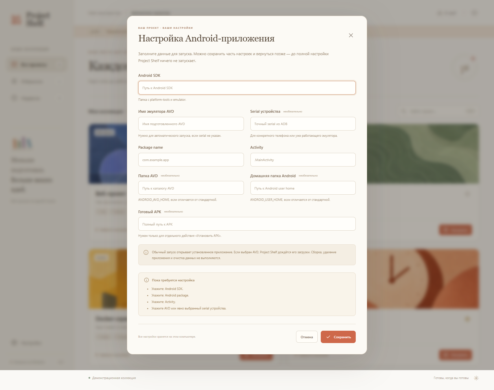
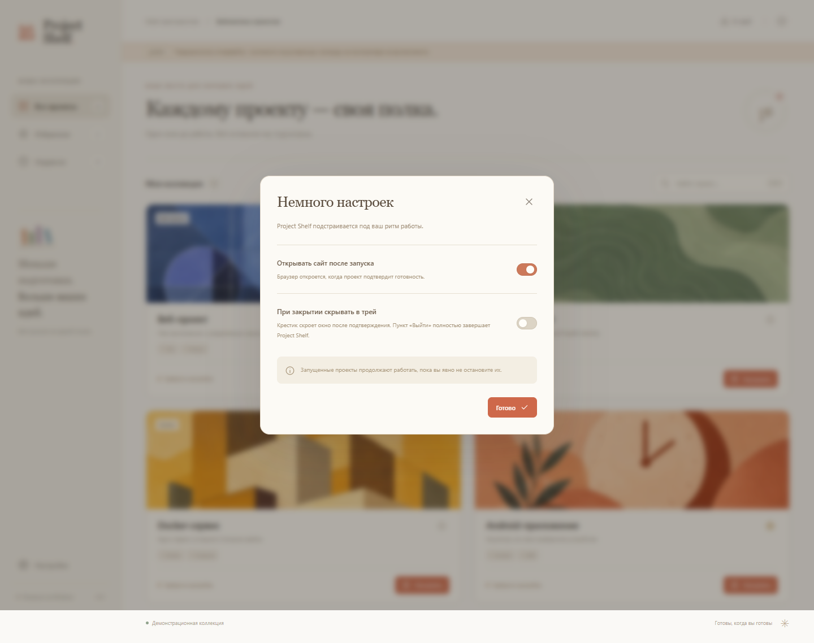
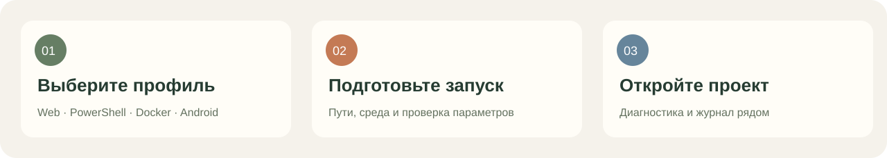
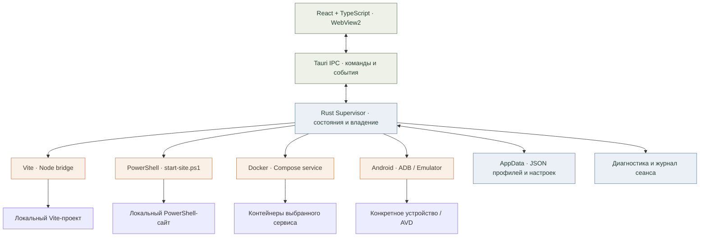

<p align="center">
  
</p>

<p align="center">
  <strong>Локальный лаунчер проектов для Windows.</strong><br />
  Vite, PowerShell, Docker Compose и Android в одном спокойном рабочем пространстве.
</p>

<p align="center">
  <a href="#quick-start">Быстрый старт</a> ·
  <a href="#screenshots">Скриншоты</a> ·
  <a href="#architecture">Архитектура</a> ·
  <a href="docs/GUIDE.md">Руководство</a> ·
  <a href="docs/TESTING.md">Проверки</a>
</p>

<p align="center"><strong>Windows x64</strong> · React + TypeScript · Tauri 2 + Rust · <a href="LICENSE">Apache-2.0</a></p>

## Проекты на виду, управление под контролем

Project Shelf собирает четыре типа локальных проектов в визуальную коллекцию. Вместо поиска нужного терминала: откройте карточку, проверьте готовность и запустите подготовленный проект. При этом приложение различает собственные запуски и внешние ресурсы, которыми оно не должно управлять.

- **Одна коллекция.** Иллюстрированные карточки, поиск, избранное и недавние проекты.
- **Понятный первый запуск.** Структурированные формы, проверка параметров и сохранение незавершённой настройки.
- **Диагностика рядом с действием.** Зависимости, процесс, HTTP и порт на странице проекта; для Android используются проверки ADB.
- **Явное владение.** Остановка и перезапуск доступны только там, где адаптер может подтвердить управляемый ресурс.
- **Работа в своём ритме.** Системный трей, один экземпляр приложения и выбор: оставить проекты работать или завершить управляемые запуски.

<a id="screenshots"></a>


## Интерфейс, в котором хочется работать

Реальные снимки интерфейса в браузерном demo-режиме.

### Вся коллекция перед глазами

Иллюстрированные обложки, поиск и избранное помогают вернуться к нужной идее.



### От карточки — к деталям

Диагностика, параметры и журнал собраны на странице проекта.



### Настройка без догадок

Отдельные поля для пути, среды выполнения, порта и признаков готовности.



### Разные проекты, знакомый интерфейс

<table>
<tr><td width="50%"><strong>Android на своей полке</strong></td><td width="50%"><strong>Ваш рабочий ритм</strong></td></tr>
<tr><td></td><td></td></tr>
</table>

## Четыре адаптера

| Профиль | Что запускается | Что подготовить |
| :--- | :--- | :--- |
| **Vite / Web** | Vite-сервер через API проекта с его config и плагинами | Проект с установленными зависимостями, Node.js, свободный порт и уникальный HTML-маркер |
| **PowerShell** | `start-site.ps1` с фиксированными аргументами | Совместимый `/api/health`, папку сайта, порт и имя сервиса |
| **Docker Compose** | Один сервис указанного Compose-файла | Docker Desktop / Linux Engine, локальный образ и HTTP `/health` |
| **Android** | Установленное приложение на выбранном устройстве или AVD | Android SDK, конкретный serial или AVD, package name и Activity |

Установка подготовленного APK доступна отдельным подтверждаемым действием. Shelf не запускает Gradle, не выполняет `npm install` в ваших проектах и не скачивает Docker-образы. [Параметры и health-контракты →](docs/GUIDE.md)

<a id="quick-start"></a>


## Быстрый старт



### Посмотреть интерфейс

Нужны **Node.js 24+ и npm**. В корне клонированного репозитория:

```powershell
npm ci --ignore-scripts
npm run dev
```

Откройте `http://127.0.0.1:1420`. Браузерный demo не имеет доступа к управлению процессами ОС.

### Собрать Windows-приложение

Дополнительно нужны **Rust 1.90+ с MSVC**, **Microsoft C++ Build Tools с Windows SDK** и **WebView2 Runtime**. Инструменты должны быть доступны в `PATH`.

```powershell
npm run desktop:build
```

Tauri соберёт frontend и нативное приложение:

- EXE: `src-tauri/target/release/project-shelf.exe`
- Установщик NSIS: `src-tauri/target/release/bundle/nsis/`

Для нативной разработки: `npm run tauri -- dev`. Альтернативный [PowerShell helper](scripts/Build-ProjectShelf.ps1) и требования к распространению описаны в [руководстве](docs/GUIDE.md).

### Подключить свой проект

1. Нажмите **«Настроить»** на нужной карточке.
2. Заполните пути, runtime и параметры готовности. Неполную настройку можно сохранить.
3. Сохраните профиль, затем отдельно нажмите **«Запустить»**.
4. Проверьте диагностику и журнал на странице проекта.

Настраивайте только доверенные проекты: Vite config и PowerShell-скрипт исполняют код с правами текущего пользователя. Приложение не меняет системную политику выполнения PowerShell.

<a id="architecture"></a>


## Архитектура

Frontend собирается в статические файлы и встраивается в приложение. В готовом EXE **нет собственного HTTP backend или обязательного Node.js для интерфейса**. Node нужен отдельно для Vite-проектов.



**Где находится логика**

| Слой | Код | Ответственность |
| :--- | :--- | :--- |
| Интерфейс | [`src/App.tsx`](src/App.tsx), [`src/components`](src/components) | Коллекция, формы, диагностика и журнал |
| Мост UI | [`src/lib/api.ts`](src/lib/api.ts) | Типизированные вызовы IPC и изолированный browser demo |
| Нативный вход | [`src-tauri/src/lib.rs`](src-tauri/src/lib.rs) | Команды Tauri, окно, трей и single-instance |
| Управление | [`supervisor.rs`](src-tauri/src/supervisor.rs), [`runtime.rs`](src-tauri/src/runtime.rs) | Сериализация действий, состояния и владение процессами |
| Адаптеры | [`src-tauri/src/adapters`](src-tauri/src/adapters) | Ограниченные команды четырёх типов проектов |
| Данные | [`store.rs`](src-tauri/src/store.rs), [`validate.rs`](src-tauri/src/validate.rs) | Атомарная запись JSON и серверная валидация |

[Подробная архитектура и границы доверия →](docs/ARCHITECTURE.md)

## Как устроена безопасность запуска

**Проверка конфигурации → проверка ресурса → запуск → подтверждение готовности → открытие.**

- Неполный профиль не запускает инструменты и не выполняет probes своего адаптера.
- Проверки HTTP ограничены loopback. Redirects и proxy для health-проверок выключены.
- Занятый чужим процессом порт не освобождается принудительно.
- Vite закрывается через собственный stdin-канал и `server.close()`, без принудительного kill по таймауту.
- PowerShell-сайт не останавливается автоматически: универсального безопасного shutdown-контракта нет.
- Docker Stop адресует подтверждённые собственные container IDs; тома и Docker Desktop не удаляются.
- Android адресует конкретный serial; внешние эмуляторы не завершаются, данные не очищаются.
- После перезапуска Shelf прежние ресурсы считаются внешними. Владение не переносится между сеансами.

Профили хранятся в AppData приложения `app.projectshelf.launcher`, недавние проекты в localStorage WebView, ограниченный журнал в памяти текущего сеанса. Секреты и пользовательские конфигурации не следует добавлять в репозиторий.


## Проверки и качество

```powershell
npm run build
npm test
npm run test:ui
node --test scripts/ci-verify.test.mjs
cargo test --manifest-path src-tauri/Cargo.toml --locked
```

Node-тесты проверяют контракты и Vite bridge на временных mock-проектах. Playwright использует Microsoft Edge и loopback-порт 1421 для demo/mocked-native сценариев. Rust-тесты проверяют backend helpers. Эти проверки **не заменяют** отдельную приёмку реальных Docker/Android/PowerShell-интеграций и Windows-дистрибутива.

`node scripts/ci-verify.mjs source` выполняется только внутри одобренного GitHub Actions run; локально проверяются его unit-тесты.

Windows workflow запускается вручную, после проверки включённой квоты. Автоматического CI на каждый push нет, поэтому здесь нет декоративного «build passing» бейджа. [Проверки](docs/TESTING.md) · [Windows review build](docs/CI_WINDOWS.md) · [Диагностика готовности](docs/READINESS.md)

## Документация

- [Руководство пользователя и сборка](docs/GUIDE.md)
- [Архитектура и ограничения](docs/ARCHITECTURE.md)
- [Диагностика готовности](docs/READINESS.md)
- [Тестирование](docs/TESTING.md)
- [Приватная Windows-сборка](docs/CI_WINDOWS.md)
- [Скриншоты и оформление README](docs/README_VISUALS.md)

## Лицензия

Оригинальный код: [Apache License 2.0](LICENSE). Уведомления: [NOTICE](NOTICE) и [THIRD_PARTY_NOTICES](THIRD_PARTY_NOTICES.md). Сторонние компоненты сохраняют собственные лицензии.

При распространении сборки сохраняйте `LICENSE`, `NOTICE`, `THIRD_PARTY_NOTICES.md` и каталог `licenses`. Перед бинарным релизом проверьте фактическое содержимое установщика и уведомления его точного набора зависимостей.
